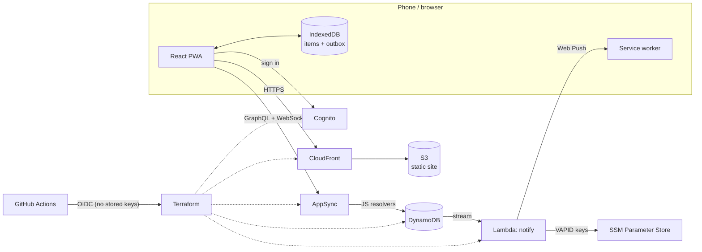

# Shared Grocery List

A real-time, offline-first shopping list for two or more people, built on a fully serverless AWS stack and deployed entirely through Terraform and GitHub Actions.

[](https://github.com/Bagi0402/grocery-list-check-project/actions/workflows/deploy.yml)
[](https://github.com/Bagi0402/grocery-list-check-project/actions/workflows/pr-checks.yml)

**Live demo:** (https://bagi0402.github.io/groceries) — sign up with any email address, create a list, and open it in a second browser to see live sync.


---

## Features

- **Shared lists**: create a list and invite others with an 8-character code.
- **Live sync**: changes appear on everyone's screen within a second (GraphQL subscriptions over WebSockets).
- **Works offline**: add, tick and delete items with no signal; changes sync automatically when you reconnect.
- **Item assignment**: mark who's buying what and filter by *Mine / Theirs / Anyone*.
- **Push notifications**: "Mr.X added Milk for you to buy", delivered even when the app is closed.
- **Installable**: add to the home screen on iPhone or Android and use it like a native app.

## Architecture



| Layer | Service | Why |
|---|---|---|
| Frontend | React + Vite + TypeScript, PWA | Fast static build, installable, offline app shell |
| Offline storage | IndexedDB via Dexie | Local source of truth for the UI; outbox for pending changes |
| Hosting | S3 + CloudFront (Origin Access Control) | Private bucket, HTTPS, global caching, security headers |
| Auth | Cognito user pools (SRP) | Managed sign-up, email verification, tokens |
| API + realtime | AppSync (GraphQL), pipeline resolvers in JavaScript | Subscriptions over WebSockets; no servers to run |
| Database | DynamoDB (on-demand), Streams, TTL | Serverless, pay-per-request, change events for notifications |
| Notifications | Lambda (Node.js, arm64) + Web Push | Triggered by DynamoDB Streams; keys in SSM |
| Infrastructure | Terraform (modules, S3 remote state with native locking) | Everything reproducible from code |
| CI/CD | GitHub Actions + OIDC | Plan on pull requests, apply and deploy on merge |
| Monitoring | CloudWatch alarms + dashboard, SNS email alerts, custom metrics (Embedded Metric Format) | Know about failures before users do; see API, real-time and notification health on one screen |
| Tracing and uptime | AWS X-Ray; scheduled GitHub Actions uptime check | Follow one request across AppSync and Lambda; free outside-in check that the site is up |

## How it works

### Security model
Every request is authorised **on the server**. Each AppSync operation runs as a *pipeline*: the first function, `checkMembership`, rejects anyone who isn't a member of the list, including clients trying to subscribe to another list's live updates. The app can't bypass it. This was tested with a second user, who gets `Unauthorized` until they join with the invite code.

### Offline-first sync
1. Every change is written to IndexedDB **and** queued in an *outbox*, in one transaction. The UI reads only from IndexedDB, so it behaves the same online or offline.
2. When online, the outbox is sent in order. The queue is **compacted**: ten offline edits to the same item become one request, because each entry carries the item's full state.
3. Errors are classified: network failures stay queued and retry; conflicts mean the server keeps its newer edit; permanent errors are dropped so the queue can't get stuck.
4. On reconnect, the app pulls the list's items/details and merges it, keeping any local edit that is newer or still unsent.
5. Item IDs are UUIDs generated **on the device**, so items can be created offline without asking the server for an ID.

### Conflict resolution
Last-write-wins on `updatedAt`, enforced by a DynamoDB **conditional write** (`attribute_not_exists(id) OR updatedAt < :incoming`). Deletes are **soft** (`deletedAt`) so they sync like any other change, and a TTL attribute (`purgeAt`) removes them for good after 30 days.

### Notifications
DynamoDB Streams trigger a Lambda that groups changes per list (with a 5-second batching window), works out who changed what, and sends one Web Push notification to every *other* member's devices. Stream records for TTL clean-ups are filtered out before the Lambda runs. Expired subscriptions (HTTP 410) are deleted automatically.

## Key decisions and trade-offs

| Decision | Why | Trade-off / alternative considered |
|---|---|---|
| Last-write-wins on device timestamps | Simple, predictable, enough for a shopping list | Relies on device clocks; CRDTs would merge field-level edits but add complexity |
| Full-list pull on reconnect instead of "changes since" | Device timestamps can be *older* than the last sync (a phone offline for days), so a "changes since" query could miss edits | More data per pull; fine for lists of hundreds of items. A `byUpdatedAt` index exists for a server-timestamp version later |
| Hand-written outbox instead of a sync framework | Full control and understanding of the sync rules | More code than RxDB / Amplify DataStore (now a legacy Gen 1 feature) |
| Four simple DynamoDB tables | Easy to read and explain | Single-table design would reduce round trips |
| Membership in DynamoDB, not Cognito groups | Users can create and join households without admin rights | Membership is checked in every resolver |
| VAPID keys created by a script, not Terraform | Keeps secrets out of Terraform state | One manual setup step |
| Deploy role with broad permissions, locked to `main` | Terraform manages IAM, AppSync, Cognito, etc. | A permissions boundary would tighten it further |
| OIDC trust on GitHub's immutable owner/repo IDs | Protects against "repo-jacking" if the repo is renamed | Must match GitHub's exact `sub` claim format |
| CloudWatch rather than a third-party tool (e.g. Datadog, Grafana) | Built into AWS, covered by the free tier, no extra accounts or agents | Fewer features and less polished dashboards than specialist tools |
| Custom metrics via Embedded Metric Format | Tracks product health (notifications sent/failed) with no extra API calls or permissions | Adds log volume; custom metrics cost money beyond the free tier |
| Alarms treat missing data as "not breaching" | In a low-traffic app, no data usually means no activity, so this avoids false alarms | An outage with zero traffic wouldn't trigger the API alarms; the uptime check covers that case |
| Uptime check on GitHub Actions, not CloudWatch Synthetics | Free for public repositories | Runs every 2 hours rather than every minute; GitHub pauses scheduled workflows after 60 days without repo activity |

## Engineering challenges solved

- **GitHub OIDC kept being rejected**, even though the trust policy looked right. CloudTrail showed GitHub's token `sub` claim includes immutable IDs (`repo:Owner@123/repo@456:ref:refs/heads/main`), not just the repo name. The trust policy now matches that format.
- **Renaming a Terraform resource** would have deleted and recreated a DynamoDB table. A `moved` block made it a safe rename.
- **Service worker updates.** Long-lived CDN caching would have frozen users on old versions. The deploy script uploads hashed assets first with one-year caching, then `index.html`, `sw.js` and the manifest with `no-cache`, and invalidates only those paths.
- **AppSync subscriptions** only deliver fields that the *mutation* requested; mutations and the subscription share one field list to avoid silent gaps.
- **Amplify's TypeScript types** expect generated GraphQL types; a typed helper handles plain GraphQL strings.

## Cost

Designed to stay within AWS free tiers for a few users: no servers, no NAT gateways, nothing billed by the hour. DynamoDB is on-demand, Lambda and CloudFront have permanent free allowances, and an AWS Budgets alert emails at $1.

## Repository layout

```
app/                    React + Vite PWA (TypeScript)
  src/offline/          Dexie database and sync engine (+ unit tests)
  e2e/                  Playwright two-user tests
infra/
  bootstrap/            Terraform state bucket
  modules/              auth, data, api, hosting, github-ci, notifications, monitoring
  envs/dev/             Wires the modules together (monitoring.tf: alarms, dashboard, alert email)
lambdas/notify/         Push-notification Lambda (also emits custom metrics)
scripts/                deploy-app.sh, setup-vapid.sh
.github/workflows/      PR checks, deploy, E2E, uptime check
```

## Running it yourself

**Prerequisites:** an AWS account, Terraform 1.10+, Node.js LTS, AWS CLI v2.

```bash
# 1. Remote state (one time)
cd infra/bootstrap && terraform init && terraform apply

# 2. Infrastructure
cd ../envs/dev            # set github_repo in hosting.tf and the email in notifications.tf
(cd ../../../lambdas/notify && npm ci --omit=dev)
terraform init && terraform apply

# 3. Push-notification keys (one time)
cd ../../.. && bash scripts/setup-vapid.sh

# 4. Build and deploy the app
bash scripts/deploy-app.sh
```

For local development: `cd app && npm run dev` (after step 4 has written `app/.env.local`).

## Testing

| What | Command | Covers |
|---|---|---|
| Unit tests | `cd app && npm test` | Sync engine: outbox compaction, retry vs conflict handling, last-write-wins merge, pull reconciliation |
| Type check + build | `cd app && npm run build` | Whole app |
| End-to-end | `cd app && npm run test:e2e` | Two real browser sessions: live sync, and an offline edit syncing after reconnect |
| Infrastructure | PR checks workflow | `terraform fmt`, `validate` and `plan` on every pull request |

## Roadmap

- Leave or delete a list, remove members, and generate a new invite code (owner-only actions, enforced in the API)
- Server-assigned timestamps for incremental sync on large lists.
- Shared expenses ("you owe Sam $14.50") and smart "you usually buy milk every 6 days" suggestions.

## Author

**Bhargavi Akula**: [GitHub](https://github.com/Bagi0402) · [LinkedIn](https://www.linkedin.com/in/bhargavi-akula-16793434)
