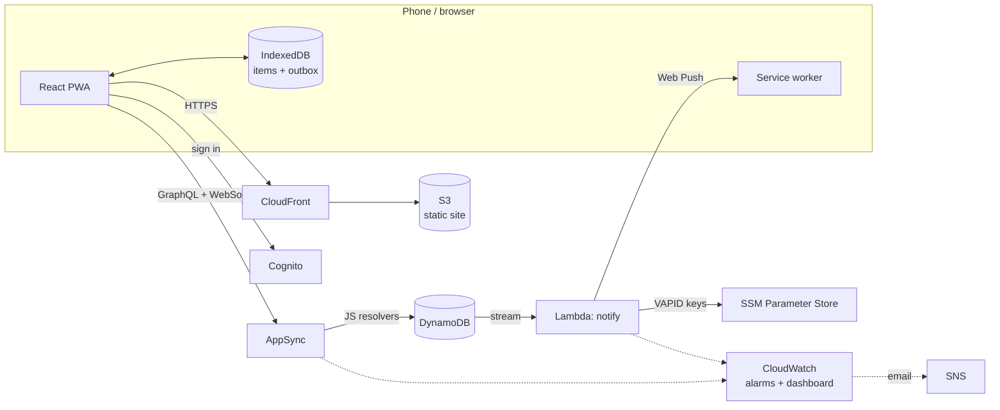
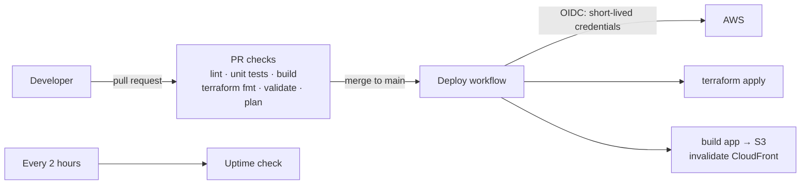
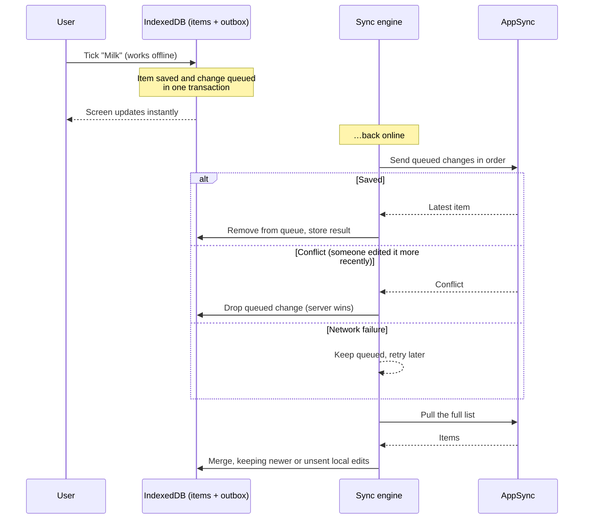
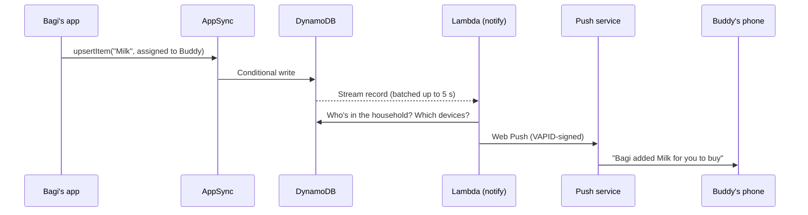

# 🛒 Shared Grocery List

A real-time, offline-first shopping list that two or more people can share. It runs on a fully serverless AWS stack and is deployed entirely through Terraform and GitHub Actions.

[](https://github.com/Bagi0402/grocery-list-check-project/actions/workflows/deploy.yml)
[](https://github.com/Bagi0402/grocery-list-check-project/actions/workflows/pr-checks.yml)
[](https://github.com/Bagi0402/grocery-list-check-project/actions/workflows/uptime.yml)


| | |
|---|---|
| **Live app** | https://YOUR-ID.cloudfront.net |
| **Demo video** | [Watch the 2-minute walkthrough](https://YOUR-VIDEO-LINK) |
| **Try it** | Sign up with any email address, create a list, then open the app in a second browser (or on a second phone) signed in as another user, and join with the invite code. |


---

## Contents

1. [Why I built this](#why-i-built-this)
2. [Features](#features)
3. [Tech stack](#tech-stack)
4. [Architecture](#architecture)
5. [Data model](#data-model)
6. [API](#api)
7. [How it works](#how-it-works)
   - [Security model](#security-model)
   - [Real-time sync](#real-time-sync)
   - [Offline-first sync](#offline-first-sync)
   - [Conflict resolution](#conflict-resolution)
   - [Push notifications](#push-notifications)
8. [Monitoring and observability](#monitoring-and-observability)
9. [Infrastructure as code](#infrastructure-as-code)
10. [CI/CD](#cicd)
11. [Getting started](#getting-started)
12. [Testing](#testing)
13. [Cost](#cost)
14. [Design decisions and trade-offs](#design-decisions-and-trade-offs)
15. [Engineering challenges solved](#engineering-challenges-solved)
16. [Troubleshooting](#troubleshooting)
17. [Roadmap](#roadmap)
18. [Author and licence](#author-and-licence)

---

## Why I built this

Shared shopping lists usually break down in two places: the person at the shop has **poor signal**, and the person at home **doesn't know what's already been bought**. I wanted an app that:

- keeps everyone's list in sync **instantly**,
- keeps working **with no connection** and catches up automatically,
- **tells you** when someone else changes the list, and
- costs close to nothing to run.

I also used it to practise building and running a production-style system end to end: infrastructure as code, keyless CI/CD, automated tests, and monitoring with alerts.

## Features

| Feature | Details |
|---|---|
| 👥 **Shared households** | Create a list and invite others with an 8-character code. A user can belong to several lists. |
| ⚡ **Live sync** | Changes appear on everyone's screen within about a second (GraphQL subscriptions over WebSockets). |
| 📴 **Works offline** | Add, tick, edit and delete with no signal. Changes are saved on the device and sync automatically on reconnect. |
| 🙋 **Item assignment** | Mark who's buying each item; filter by **Mine / Theirs / Anyone**. |
| 🔔 **Push notifications** | e.g. *"Bagi added Milk for you to buy"*, delivered even when the app is closed. Bursts of edits are combined into one notification. |
| 📱 **Installable (PWA)** | Add to the home screen on iPhone or Android; opens like a native app, including offline. |
| 🗂️ **Smart ordering** | Unbought items first, grouped by category (Produce, Dairy, Bakery…). |
| 🔐 **Private by design** | Server-side membership checks on every request; each user's offline data is stored separately and wiped on sign-out. |

<!-- Add screenshots here, e.g.
| Sign in | Shared list | Offline | Notification |
|---|---|---|---|
|  |  |  |  |
-->

## Tech stack

| Layer | Technology |
|---|---|
| Frontend | React, TypeScript, Vite, Amplify UI (sign-in screens), `vite-plugin-pwa` (Workbox service worker) |
| Offline storage | IndexedDB via **Dexie** (`dexie-react-hooks` for live queries) |
| Hosting | **S3** (private) + **CloudFront** with Origin Access Control |
| Authentication | **Amazon Cognito** user pools (SRP sign-in, email verification) |
| API and real-time | **AWS AppSync** (GraphQL) with JavaScript pipeline resolvers |
| Database | **Amazon DynamoDB** (on-demand), Streams, TTL, point-in-time recovery |
| Notifications | **AWS Lambda** (Node.js 22, arm64) + Web Push (VAPID), keys in **SSM Parameter Store** |
| Monitoring | **CloudWatch** alarms, dashboard, Embedded Metric Format, **SNS** email alerts, **X-Ray** tracing |
| Infrastructure as code | **Terraform** (modular), S3 remote state with native locking |
| CI/CD | **GitHub Actions** with **OIDC** (no long-lived AWS keys) |
| Testing | **Vitest** + `fake-indexeddb` (unit), **Playwright** (end-to-end) |

## Architecture

### System overview



### Delivery pipeline



### Services at a glance

| Service | Role in the app | Managed by |
|---|---|---|
| CloudFront + S3 | Serves the built app over HTTPS with security headers and SPA routing | Terraform (`hosting`) |
| Cognito | Sign-up, sign-in, email verification, tokens (30-day refresh tokens so offline users stay signed in) | Terraform (`auth`) |
| AppSync | GraphQL API, membership checks, live updates | Terraform (`api`) |
| DynamoDB | Households, memberships, items, push subscriptions | Terraform (`data`) |
| Lambda | Turns item changes into push notifications | Terraform (`notifications`) |
| SSM Parameter Store | Stores the VAPID key pair (private key encrypted) | `scripts/setup-vapid.sh` |
| CloudWatch, SNS, X-Ray | Alarms, dashboard, custom metrics, email alerts, tracing | Terraform (`monitoring`) |
| IAM + GitHub OIDC | Least-privilege roles for AppSync, Lambda and CI | Terraform (`github-ci`, per module) |

## Data model

Four DynamoDB tables, designed around the questions the app asks (its *access patterns*), so every lookup is a single key-based request.

| Table | Partition key | Sort key | Indexes / features | Holds |
|---|---|---|---|---|
| `households` | `id` | – | GSI `byInviteCode` (projection ALL) | List name, invite code, creator |
| `members` | `householdId` | `userId` | GSI `byUser` (`userId` → `householdId`) | Who belongs to which list, display name, role |
| `items` | `householdId` | `id` | GSI `byUpdatedAt`; **Stream** (new and old images); **TTL** on `purgeAt`; point-in-time recovery | The shopping items |
| `push_subscriptions` | `userId` | `endpointHash` | – | One row per device that has notifications turned on |

| Question the app asks | How it's answered |
|---|---|
| Is this user a member of this list? | `GetItem` on `members` (`householdId` + `userId`) |
| Which lists am I in? | `Query` on `members.byUser` |
| What's on this list? | `Query` on `items` by `householdId` |
| Which list does this invite code belong to? | `Query` on `households.byInviteCode` |
| Which devices should get this notification? | `Query` on `push_subscriptions` by `userId` |

**Item fields:** `householdId`, `id` (UUID generated on the device), `name`, `qty`, `category`, `checked`, `assignedTo`, `updatedAt`, `updatedBy`, `deletedAt`, `purgeAt`.

**Billing:** all tables use on-demand capacity, so there's nothing to tune and an idle table costs nothing. The `byUpdatedAt` index was planned up front for incremental ("what changed since…") sync; see [Design decisions](#design-decisions-and-trade-offs) for why the app currently pulls the full list instead.

## API

GraphQL schema: [`infra/modules/api/schema.graphql`](infra/modules/api/schema.graphql). Every operation runs as an AppSync **pipeline** of small, reusable JavaScript functions.

| Operation | Type | Pipeline |
|---|---|---|
| `myHouseholds` | Query | `myHouseholds` |
| `householdMembers(householdId)` | Query | **`checkMembership`** → `listMembers` |
| `listItems(householdId)` | Query | **`checkMembership`** → `listItems` |
| `itemsChangedSince(householdId, since)` | Query | **`checkMembership`** → `itemsChangedSince` |
| `createHousehold(name, displayName)` | Mutation | `createHousehold` → `putMember` |
| `joinHousehold(inviteCode, displayName)` | Mutation | `findHouseholdByInvite` → `putMember` |
| `upsertItem(input)` | Mutation | **`checkMembership`** → `upsertItem` (conditional write) |
| `deleteItem(householdId, id, updatedAt)` | Mutation | **`checkMembership`** → `deleteItem` (soft delete) |
| `savePushSubscription(input)` | Mutation | `savePushSubscription` (HTTPS endpoints only) |
| `deletePushSubscription(endpointHash)` | Mutation | `deletePushSubscription` |
| `onItemChanged(householdId)` | Subscription | **`checkMembership`**, triggered by `upsertItem` / `deleteItem` |

## How it works

### Security model

- **Authorisation happens on the server.** Every list operation, *including subscribing to live updates*, starts with `checkMembership`, which rejects anyone who isn't in the household. This was verified with a second user, who receives `Unauthorized` until they join with the invite code.
- **Least privilege.** AppSync's role can only `GetItem / PutItem / UpdateItem / Query / DeleteItem` on its tables. The Lambda can only read the stream, query members, manage subscriptions and read its own SSM parameters.
- **No stored cloud keys.** GitHub Actions signs in to AWS with OIDC. The deploy role trusts only the `main` branch of this repository, identified by GitHub's **immutable owner and repo IDs**, so a renamed or re-created repo can't take over its access.
- **Secrets stay out of code and Terraform state.** The VAPID private key is generated by a script and stored as an encrypted SSM parameter.
- **Private hosting.** The S3 bucket blocks all public access; only this CloudFront distribution can read it (Origin Access Control). CloudFront adds standard security headers.
- **Shared devices.** Each user gets their own on-device database, which is deleted on sign-out together with the device's push subscription.

### Real-time sync

When a client calls `upsertItem` or `deleteItem`, AppSync pushes the result to every client subscribed to `onItemChanged` for that household over a WebSocket. Mutations and the subscription request the **same field list**, because AppSync subscribers only receive fields that the mutation asked for.

### Offline-first sync



Key points:

1. **The screen reads only from IndexedDB**, so the app behaves identically online and offline, and every change appears instantly (optimistic UI) before the server confirms it.
2. **Outbox compaction:** each queued change carries the item's full state, so ten offline edits to one item become a single request.
3. **Errors are classified:** network failures retry (on reconnect, when the tab becomes visible, and every 30 seconds); conflicts are dropped; permanent errors are dropped and reported so the queue can never get stuck.
4. **Device-generated UUIDs** mean items can be created offline without asking the server for an ID.
5. **The service worker** precaches the app shell, so the app opens with no connection. Households and members are also cached on the device.
6. **The server stays the source of truth.** Browsers can clear website storage (Safari is especially strict for sites that haven't been used recently). The app asks for persistent storage with `navigator.storage.persist()`, and if a device's data is wiped anyway, it simply re-downloads the list. Only unsent offline edits could be lost.

The sync engine is in [`app/src/offline/sync.ts`](app/src/offline/sync.ts).

### Conflict resolution

**Last write wins**, based on `updatedAt` (the time of the edit on the device), and enforced in DynamoDB with a conditional write:

```
attribute_not_exists(id) OR updatedAt < :incomingUpdatedAt
```

- A write that is older than what the server has is rejected with a `Conflict` error, and the client drops it.
- Deletes are **soft**: they set `deletedAt`, so a deletion syncs to other devices like any other change. A **TTL** attribute (`purgeAt`) removes deleted items for good after 30 days.

### Push notifications



- **Batched and grouped:** a 5-second batching window turns a burst of edits into one notification per person, for example *"Bagi bought Bread · …and 3 more changes"*.
- **Never notifies you about your own changes.**
- **Personalised:** "added Milk **for you to buy**" only for the person the item is assigned to.
- **Self-cleaning:** if a push service replies *404/410*, that device's subscription is deleted.
- **Filtered at the source:** TTL deletions (`REMOVE` stream events) are filtered out before the Lambda is invoked.
- **iPhone:** web push works for apps added to the Home Screen (iOS 16.4+); the app explains this when needed.

## Monitoring and observability

| What | Details |
|---|---|
| **Alarms → email (SNS)** | AppSync server errors (5XX) · AppSync p90 latency > 1.5 s · Lambda errors · Lambda stream lag > 5 min (`IteratorAge`) · 5+ failed push notifications in an hour |
| **Dashboard** | Alarm status, API requests and errors, latency (p50/p90), open WebSocket connections and live updates delivered, notifications sent/failed/expired, Lambda invocations/errors/duration, DynamoDB activity, recent notification logs |
| **Custom business metrics** | `NotificationsSent`, `NotificationsFailed`, `ExpiredSubscriptionsRemoved`, emitted by the Lambda using CloudWatch **Embedded Metric Format** (a structured log line, with no extra API calls) |
| **Tracing** | AWS X-Ray across AppSync and the notify Lambda (DynamoDB, SSM and push calls) |
| **Uptime** | A scheduled GitHub Actions workflow checks the site, manifest and service worker every 2 hours |
| **Logs** | AppSync (errors) and Lambda logs in CloudWatch, 14-day retention |

**Testing the alerting path:**

```bash
aws cloudwatch set-alarm-state \
  --alarm-name gcl-dev-notify-errors \
  --state-value ALARM \
  --state-reason "Testing that alert emails work"
```

An "ALARM" email arrives within a minute, followed by an "OK" email when the alarm re-evaluates the real metric.

**Dashboard link:** `terraform -chdir=infra/envs/dev output dashboard_url`

<!--  -->

## Infrastructure as code

Everything except the one-time state bucket and the VAPID keys is created by Terraform.

```
infra/
├── bootstrap/          # S3 bucket for Terraform state (run once, local state)
├── modules/
│   ├── auth/           # Cognito user pool + web client
│   ├── data/           # DynamoDB tables, indexes, stream, TTL
│   ├── api/            # AppSync API, schema, data sources, JS resolvers, IAM, logs
│   ├── hosting/        # S3 bucket, CloudFront, Origin Access Control, bucket policy
│   ├── github-ci/      # GitHub OIDC provider, deploy and plan roles
│   ├── notifications/  # Lambda, IAM, stream trigger (with filter), logs, X-Ray
│   └── monitoring/     # SNS topic, alarms, dashboard
└── envs/
    └── dev/            # Wires the modules together (main.tf, hosting.tf, notifications.tf, monitoring.tf)
```

- **Remote state** in S3 with versioning, encryption, and **native S3 locking** (`use_lockfile = true`, Terraform 1.10+).
- **Default tags** (`Project`, `Environment`, `ManagedBy`) on every resource.
- **Safe refactoring** with `moved` blocks (e.g. renaming a table resource without replacing the table).

**Useful outputs** (`terraform output`): `user_pool_id`, `web_client_id`, `graphql_url`, `site_url`, `site_bucket`, `cloudfront_distribution_id`, `deploy_role_arn`, `plan_role_arn`, `notify_function_name`, `vapid_public_param`, `dashboard_url`.

## CI/CD

| Workflow | Trigger | What it does |
|---|---|---|
| `pr-checks.yml` | Pull request to `main` | **App:** install, lint, unit tests, type-check and build. **Infra:** `terraform fmt -check`, `validate`, `plan` (read-only role), with the plan shown in the run summary |
| `deploy.yml` | Push to `main`, or manual | `terraform apply`, then build the app and publish to S3 and CloudFront |
| `e2e.yml` | Manual | Two-user Playwright tests against the live site |
| `uptime.yml` | Every 2 hours, or manual | Checks the live site is serving the app |

**Cache-safe releases** ([`scripts/deploy-app.sh`](scripts/deploy-app.sh)):

1. Hashed assets are uploaded **first**, cached for a year (`immutable`).
2. `index.html`, `sw.js`, `registerSW.js`, `push-sw.js` and the manifest are uploaded **last** with `no-cache`.
3. Only those entry files are invalidated in CloudFront.

Visitors never get a page that points to files that don't exist yet, and new versions (including service-worker updates) reach users straight away.

**GitHub configuration:**

| Type | Name | Purpose |
|---|---|---|
| Variable | `AWS_DEPLOY_ROLE_ARN` | Role assumed by the Deploy workflow |
| Variable | `AWS_PLAN_ROLE_ARN` | Read-only role assumed by PR checks |
| Variable | `E2E_BASE_URL` | Live site address (E2E and uptime checks) |
| Secret | `E2E_USER_A_EMAIL`, `E2E_USER_A_PASSWORD`, `E2E_USER_B_EMAIL`, `E2E_USER_B_PASSWORD` | Two test users who share one household |

## Getting started

### Prerequisites

- An AWS account (with an IAM Identity Center user and a budget alert)
- [Terraform](https://developer.hashicorp.com/terraform/install) **1.10+**
- [AWS CLI v2](https://docs.aws.amazon.com/cli/latest/userguide/getting-started-install.html), signed in (`aws sso login --profile <profile>`)
- Node.js LTS (e.g. via `fnm`)
- A GitHub repository (for CI/CD)

### 1. Create the Terraform state bucket (once)

```bash
export AWS_PROFILE=<your-profile>
cd infra/bootstrap
terraform init && terraform apply
```

Put the printed bucket name in `infra/envs/dev/backend.tf`.

### 2. Configure

| File | Setting |
|---|---|
| `infra/envs/dev/main.tf` | `name_prefix` (e.g. `gcl-dev`) |
| `infra/envs/dev/hosting.tf` | `github_repo`: GitHub's OIDC subject format, `Owner@<ownerId>/repo@<repoId>` |
| `infra/envs/dev/notifications.tf` | `vapid_subject` (`mailto:you@example.com`) |
| `infra/envs/dev/monitoring.tf` | `alert_email` |

### 3. Deploy the infrastructure

```bash
(cd lambdas/notify && npm ci --omit=dev)   # package the Lambda's dependency
cd infra/envs/dev
terraform init
terraform plan
terraform apply
```

Confirm the SNS subscription email that AWS sends to `alert_email`.

### 4. Create the push-notification keys (once)

```bash
cd ../../..
bash scripts/setup-vapid.sh
```

### 5. Build and deploy the app

```bash
bash scripts/deploy-app.sh
```

This writes `app/.env.local` from Terraform outputs, builds the app, uploads it and prints the site URL.

### 6. Turn on CI/CD

Add the GitHub variables and secrets listed in [CI/CD](#cicd). From then on, every merge to `main` deploys automatically.

### Local development

```bash
cd app
npm install
npm run dev        # http://localhost:5173 (uses app/.env.local)
npm run build && npm run preview   # http://localhost:4173, production build with the service worker
```

| Environment variable (`app/.env.local`) | Source |
|---|---|
| `VITE_AWS_REGION` | `ap-southeast-2` |
| `VITE_USER_POOL_ID` | `terraform output user_pool_id` |
| `VITE_USER_POOL_CLIENT_ID` | `terraform output web_client_id` |
| `VITE_GRAPHQL_URL` | `terraform output graphql_url` |
| `VITE_VAPID_PUBLIC_KEY` | SSM parameter `terraform output vapid_public_param` |

`deploy-app.sh` writes this file for you. Vite reads it only at start-up, so restart `npm run dev` after it changes.

## Testing

| Level | Command | What it covers |
|---|---|---|
| **Unit** (9 tests) | `cd app && npm test` | The sync engine against a real Dexie database (in-memory IndexedDB): outbox compaction, sending and clearing the queue, deletions, retry on network failure, dropping conflicts, offline behaviour, last-write-wins merge, pull reconciliation |
| **Type-check and build** | `cd app && npm run build` | The whole app |
| **End-to-end** (2 tests) | `cd app && npm run test:e2e` | Two real browser sessions as two users: live add → tick → delete; and an item added **offline** that syncs to the other user after reconnecting |
| **Infrastructure** | PR checks | `terraform fmt`, `validate` and `plan` on every pull request |
| **Manual** | – | Two phones in airplane mode editing the same list, then reconnecting |

Running the E2E tests against the live site:

```bash
cd app
E2E_BASE_URL=https://YOUR-ID.cloudfront.net \
E2E_USER_A_EMAIL=... E2E_USER_A_PASSWORD=... \
E2E_USER_B_EMAIL=... E2E_USER_B_PASSWORD=... \
npm run test:e2e
```

## Cost

Built to stay within AWS free tiers for a handful of users. There are no servers, NAT gateways or anything else billed by the hour.

| Service | Usage pattern | Expected cost |
|---|---|---|
| DynamoDB (on-demand) | A few thousand requests a month; KB of data | ≈ $0 |
| AppSync | Pay per request and per connection-minute | Cents a month at most |
| Lambda | A few hundred invocations a month | Within the permanent free tier |
| CloudFront + S3 | Small static site | Within free tiers |
| Cognito | A few users | Within the free tier |
| CloudWatch | 5 alarms, 1 dashboard, 3 custom metrics, small logs | Within the free tier |
| SSM Parameter Store | 2 standard parameters | Free |
| GitHub Actions | Public repository | Free |

An **AWS Budgets** alert emails at $1 of actual spend as a safety net.

## Design decisions and trade-offs

| Decision | Why | Trade-off / alternative considered |
|---|---|---|
| **AWS rather than Supabase / Firebase** | Industry-relevant cloud skills; no project pausing after inactivity; fine-grained IAM | More setup than an all-in-one backend (Supabase would have been faster to start) |
| **Terraform rather than Amplify Gen 2 / CDK** | Widely used, cloud-agnostic infrastructure as code; explicit plans before every change | More code than Amplify's generated backend; Amplify is still used in the browser (sign-in UI and API client) |
| **React + Vite rather than Angular / Vue / Next.js** | Largest ecosystem; a static SPA is all a signed-in PWA needs | Angular includes more out of the box; Next.js server features would go unused |
| **AppSync (GraphQL) for the API** | Managed WebSocket subscriptions; no servers | Less flexible than a custom API on Lambda or containers |
| **Last-write-wins on device timestamps** | Simple, predictable, fine for a shopping list | Depends on device clocks; CRDTs would merge field-level edits but add complexity |
| **Full-list pull instead of "changes since"** | Edits made offline carry their *original* timestamps, which can be older than another device's last sync, so a "changes since" query could miss them | More data per pull (fine for hundreds of items); a server-timestamp index would enable incremental sync |
| **Hand-written outbox (Dexie) instead of a sync framework** | Full control and understanding of the sync rules | More code than RxDB (built-in replication) or Amplify DataStore (a legacy Gen 1 feature); SQLite in the browser was another option |
| **No price scraping (yet)** | Scraping supermarket sites breaks their terms and fails whenever their pages change | Price comparison waits for official retailer APIs (see [Roadmap](#roadmap)) |
| **Four simple tables** | Easy to read, explain and secure | Single-table design would reduce round trips |
| **Membership in DynamoDB, not Cognito groups** | Users create and join lists without admin rights | A membership check runs on every request |
| **Static SPA on S3 + CloudFront** | Cheap, fast, simple; works offline as a PWA | No server-side rendering (not needed for a signed-in app) |
| **VAPID keys created by a script** | Keeps secrets out of Terraform state | One manual setup step |
| **Broad deploy role, locked to `main`** | Terraform manages IAM, AppSync, Cognito and more | A permissions boundary would tighten it further |
| **Web push instead of native apps** | One codebase for every device | iPhone needs the app added to the Home Screen |
| **CloudFront default domain** | No domain cost for a portfolio project | Less memorable URL (the app is installable, so users rarely type it) |

## Engineering challenges solved

Real problems hit while building this, and how they were diagnosed:

1. **GitHub OIDC kept being rejected**, although the trust policy looked correct. **CloudTrail** showed the token's actual `sub` claim includes immutable IDs (`repo:Owner@123/repo@456:ref:refs/heads/main`), not just the repo name. The trust policy now matches that format, which also protects against repo-jacking.
2. **A resource rename would have destroyed a database table.** Renaming a Terraform resource makes Terraform plan a delete and re-create. A `moved` block turned it into a safe rename.
3. **Offline sync and clocks.** Incremental "changes since" pulls would silently miss edits from a phone that had been offline for days. This led to the full-list reconciliation design, documented above.
4. **Service-worker updates frozen by the CDN.** Year-long caching would have kept users on old versions. The deploy script separates hashed assets from entry files and invalidates only the latter.
5. **Live updates missing fields.** AppSync subscribers only receive fields the *mutation* selected; mutations and the subscription now share one field list.
6. **Typed GraphQL helper.** Amplify's TypeScript types expect generated GraphQL types; a small typed helper bridges plain query strings (code generation is on the roadmap).
7. **Local environment pitfalls.** A project scaffolded inside the wrong folder, and an `.env.local` file containing unexpanded shell commands. Both were found by checking `pwd` and the file's contents rather than guessing.

## Troubleshooting

| Symptom | Cause | Fix |
|---|---|---|
| `InvalidGrantException` / "No valid credential sources" from Terraform | AWS SSO session expired | `aws sso login --profile <profile>` |
| `Not authorized to perform sts:AssumeRoleWithWebIdentity` in GitHub Actions | Trust policy doesn't match the token's `sub` claim | Check CloudTrail `AssumeRoleWithWebIdentity` events for the real `sub` and update `github_repo` |
| `refusing to allow a Personal Access Token to create or update workflow` | Token lacks the `workflow` scope | Add the scope, or sign in with `gh auth login --scopes workflow` |
| App shows "A network error has occurred" on sign-in | `app/.env.local` has wrong or unexpanded values | Re-run `scripts/deploy-app.sh` (or recreate the file), then restart `npm run dev` |
| App shows an old version after deploying | Service worker serving the cached version | Close the app or tab completely and reopen it |
| No "Turn on" option for notifications | App built without the VAPID public key | Run `scripts/setup-vapid.sh`, then redeploy |
| Notifications log shows `0 sent` | Recipient hasn't turned notifications on (or did so before the keys existed) | Turn notifications off and on again on that device |
| iPhone doesn't offer notifications | iOS only allows web push for Home Screen apps | Share → Add to Home Screen, then open it from there |
| Uptime check fails with "Set the E2E_BASE_URL repository variable" | Variable missing (or saved as a secret) | Add it under **Variables**, not Secrets |

**Viewing Lambda logs:**

```bash
aws logs tail "/aws/lambda/$(terraform -chdir=infra/envs/dev output -raw notify_function_name)" --follow
```

## Roadmap

- [ ] **Price comparison** across Coles, Woolworths and Aldi, using official retailer price APIs (recommended by the ACCC's 2025 supermarket inquiry) rather than scraping
- [ ] GraphQL code generation for fully typed API calls
- [ ] Server-assigned timestamps for incremental sync on very large lists
- [ ] Shared expenses ("you owe Sam $14.50") and smart "you usually buy milk every 6 days" suggestions
- [ ] Aisle ordering per store, recipe-to-list import
- [ ] CloudWatch RUM for front-end error monitoring
- [ ] A permissions boundary for the CI deploy role
- [ ] A custom domain

## Author and licence

**Bhargavi Akula** · [GitHub](https://github.com/Bagi0402) · [LinkedIn](https://www.linkedin.com/in/YOUR-PROFILE)

The step-by-step build process is documented in [`docs/build-process.md`](docs/build-process.md).

Released under the [MIT Licence](LICENSE).
